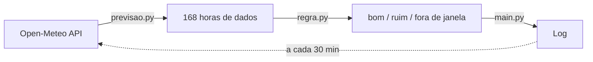

# ☁️ Nimbus

**Em quais horas vale a pena sair pra correr?**


Serviço que consulta a previsão de 7 dias e classifica **cada hora** como boa ou ruim para correr, com regras próprias de chuva, UV e sensação térmica. Roda sozinho em um container Docker, com retry e cooldown para falhas de API.

## O problema

Apps de clima respondem "como está o dia". Mas um mesmo dia pode ter uma manhã ótima e uma tarde péssima. O Nimbus responde a pergunta certa: **quais horas** valem a pena.

## Exemplo de saída

```text
INFO:root:2026-10-14T09:00 | bom
INFO:root:2026-10-14T10:00 | ruim, uv alto
INFO:root:2026-10-14T11:00 | ruim, precipitação alta
INFO:root:2026-10-14T17:00 | bom
INFO:root:2026-10-14T21:00 | fora de janela
```

## Como funciona



| Arquivo | Responsabilidade |
|---|---|
| `previsao.py` | Busca e organiza os dados da API |
| `regra.py` | Decide se cada hora é boa ou ruim |
| `main.py` | Orquestra, agenda, faz log e trata falhas |

Cada arquivo muda por um motivo diferente. A regra recebe os dados como parâmetro, então pode ser testada sem chamar a API.

## Regra de classificação

Avaliada hora a hora, apenas entre **5h e 20h** (fora disso: `fora de janela`):

1. Chance de chuva ≥ 50% → **ruim**
2. Índice UV ≥ 6 (nível "alto" da OMS) → **ruim**
3. Sensação térmica ≥ 33 °C → **ruim**
4. Caso contrário → **bom**

A ordem importa: chuva e UV vetam a hora antes da temperatura. Os limites foram testados nas bordas (49/50% de chuva, UV 5,9/6,0).

### Por que sensação térmica e UV

Em dados reais, a temperatura do ar sozinha se contradizia: 10h com 28,5 °C era pior que 18h com 29,2 °C por causa do sol. Sensação térmica combinada com UV explicou de forma consistente o que eu sinto correndo.

## Tratamento de falha da API

- **Timeout** de 10s em cada requisição
- **Retry**: 5 tentativas com 10s de intervalo (1 rodada)
- **Cooldown**: 10 min entre rodadas
- **Limite**: 6 rodadas; se todas falharem, desiste daquela execução, loga o erro e tenta de novo em 30 min

Uma falha nunca derruba o processo. Testado desligando o Wi-Fi.

## Como rodar

**Com Docker (recomendado):**

```bash
docker build -t nimbus .
docker run -d --restart unless-stopped --name nimbus nimbus
docker logs nimbus
```

**Sem Docker:**

```bash
pip install -r requirements.txt
python main.py
```

## Decisões técnicas

| Decisão | Escolha | Motivo |
|---|---|---|
| Fonte de dados | Open-Meteo | Gratuita, sem chave, com UV e sensação térmica por hora |
| Empacotamento | Docker | Ambiente reproduzível; `--restart` mantém o serviço de pé |
| Saída | Log | Suficiente para a v1; UI vem depois |
| Logs | `logging`, não `print` | Níveis, formato e destino configuráveis |
| Banco de dados | Nenhum (descartado PostgreSQL) | Sem histórico na v1; seria infraestrutura sem necessidade |
| Orquestração | Nenhuma (descartado Kubernetes/microsserviços) | Desproporcional para um serviço de uma responsabilidade |

## Limitações conhecidas

- Coordenadas e limites da regra ainda estão fixos no código
- Roda apenas enquanto a máquina e o Docker estiverem ligados
- A saída é só log, sem notificação nem interface

## Roadmap

- [ ] Configuração por variáveis de ambiente (cidade, limites, janela)
- [ ] Vento, rajadas e tempestade como vetos
- [ ] Nível "aceitável" e resumo diário
- [ ] API própria com FastAPI
- [ ] Dashboard web
- [ ] Notificações (Telegram/e-mail)
- [ ] Testes automatizados com GitHub Actions

## Sobre o projeto

Projeto de aprendizado em back-end e DevOps. Todo o backend foi escrito à mão, sem geração de código por IA. O frontend, quando existir, será feito com IA supervisionada e revisada por mim.

---

**João Pedro Carpini** · [GitHub](https://github.com/JoaoCarpini)